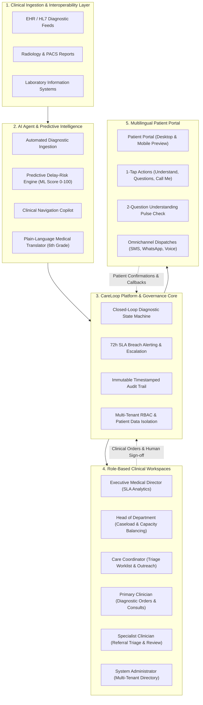
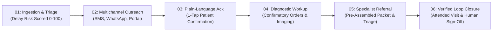

# CareLoop AI

> **Enterprise Healthcare Closed-Loop Navigation Platform**  
> *Every abnormal screening finding. Every clinical checkpoint. Verifiably closed.*

[](https://github.com/srj7042/CareLoop)
[](https://react.dev/)
[](https://www.typescriptlang.org/)
[](https://tailwindcss.com/)
[](./LICENSE)

---

## 📋 Overview

**CareLoop AI** is an enterprise clinical orchestration platform designed to eliminate care gaps between abnormal diagnostic screenings and verified treatment. In standard healthcare systems, up to 30% of abnormal findings (such as suspicious mammograms, positive colorectal FIT tests, or incidental lung nodules) are delayed or lost to follow-up due to fragmented communication and overwhelmed coordinators.

CareLoop connects hospital EHR feeds, clinical care teams, and patients through an audited 6-step closed-loop state machine, predictive machine learning risk scoring, plain-language patient translation, and strict human-in-the-loop governance.

---

## 🏛️ System Architecture



---

## 🔄 Clinical Workflow Continuum

Every abnormal finding progresses through six verifiable checkpoints with strict human-in-the-loop oversight:



### The 6 Verifiable Milestones:
1. **Automated Ingestion & Triage:** Abnormal lab or radiology result parsed; predictive delay-risk score (0–100) generated based on clinical severity, social vulnerability (SDOH), and historical compliance.
2. **Multichannel Patient Outreach:** Dispatches localized notifications across preferred channels (SMS, WhatsApp, secure portal release) under a 24-hour delivery SLA.
3. **Plain-Language Acknowledgement:** Clinical findings translated into empathetic, 6th-grade reading-level explanations; enables 1-tap confirmation or callback requests.
4. **Diagnostic Workup Orders:** Primary clinician prescribes guideline-recommended confirmatory procedures (e.g., diagnostic ultrasound, core biopsy, repeat lab).
5. **Structured Specialist Referral:** Automated pre-assembly of referral packets with relevant clinical findings; specialist accepts, rejects with documented cause, or requests further data.
6. **Verified Loop Closure:** **Loops can never close autonomously on administrative assumptions.** Documented clinical evidence (attended diagnostic appointment, treatment initiation, or active surveillance protocol) plus an immutable clinician signature is mandatory.

---

## 👥 Role-Based Workspaces

| Workspace | Target Persona | Primary Capabilities |
| :--- | :--- | :--- |
| **Executive Oversight** | Medical Director / Deans | Institutional loop closure rates, departmental comparative metrics, mean time-to-action telemetry, and systemic bottleneck watchlists. |
| **Department Command** | Heads of Department (HOD) | Caseload volume oversight, coordinator capacity meters, and unassigned triage queue rebalancing. |
| **Triage Worklist** | Care Coordinators & Navigators | Dual Table/Kanban view, SLA countdown timers, 1-click patient nudges, and multi-channel outreach logs. |
| **Case Detail & Orders** | Primary Clinicians | Protocol-driven confirmatory orders, rapid specialist consult threads, and final loop-closure sign-offs. |
| **Referral Inbox** | Specialist Clinicians | 1-click referral triage (Accept with slot booking, Request More Info, or Reject with documented clinical cause). |
| **Patient Portal** | Patients & Families | Empathetic plain-language summaries, 5 regional language toggles, 1-tap responses, and care team directory. |
| **System Governance** | Master Administrator | Multi-tenant organization directory, clinician credential management, and security audit log. |

---

## 🎨 Design System & Ergonomics (`v1.2.0`)

CareLoop AI implements a calm, high-efficiency design language tailored specifically for high-stress healthcare environments:
- **Canvas:** Multi-stop pastel background gradient (`from-[#E8EEF5] via-[#EAE8F2] to-[#F5EAF0]`).
- **Surfaces:** Semi-translucent frosted glass cards (`bg-white/80 backdrop-blur-md border border-white/80 rounded-[26px]`).
- **Interactive Micro-Interactions:** Subtle elevation (`-2.5px`), ambient shadow bloom (`shadow-[0_18px_40px_rgba(100,115,140,0.12)]`), and border clarification across all cards, blocks, and buttons.
- **Color Tokens:** Deep Charcoal (`#1E2532`), Cool Slate (`#798393`), Mint Green indicator (`#10B981`), Soft Lavender badge (`#8B5CF6`), and Alert Coral (`#EF4444`).
- **Accessibility:** High contrast ratios, WCAG 2.1 AA compliant targets, keyboard navigation support, and reduced-motion fallbacks.

---

## 🛠️ Tech Stack

- **Frontend Framework:** React 19.3 + TypeScript 5.9
- **Bundler & Tooling:** Vite 8.3
- **Styling:** Tailwind CSS v4, PostCSS
- **Component Primitives:** Custom Design System (`<GlassCard>`, `<IconButton>`, `<StatusPill>`)
- **Animation:** Motion (Framer Motion 14.6)
- **Icons & Visuals:** Lucide React
- **State Management:** Zustand (with local persistence)
- **Notifications & Feedback:** Sonner

---

## 🚀 Getting Started

### Prerequisites
- Node.js 18.x or higher
- npm 9.x or higher (or pnpm / yarn)

### Quick Start

```bash
# 1. Clone the repository
git clone https://github.com/srj7042/CareLoop.git
cd CareLoop

# 2. Install dependencies
npm install

# 3. Start development server
npm run dev
```

Visit `http://localhost:5173` to explore the public landing page and interactive clinical workspaces.

### Verification & Production Build

```bash
# Run TypeScript compilation and Vite production build
npm run build

# Run code linter
npm run lint
```

---

## 🔒 Security & Data Privacy

- **HIPAA-Aligned Safeguards:** Role-based access control (RBAC), multi-tenant data isolation, and audit logging for all patient health information (PHI) interactions.
- **Human-in-the-Loop AI:** AI suggestions never execute autonomously without licensed clinician confirmation.
- **Zero Fabrication Guarantee:** Uses realistic clinical scenarios and evidence-grounded logic without fabricated operational statistics or simulated certifications.

---

## 📄 License

This project is licensed under the [MIT License](./LICENSE).
