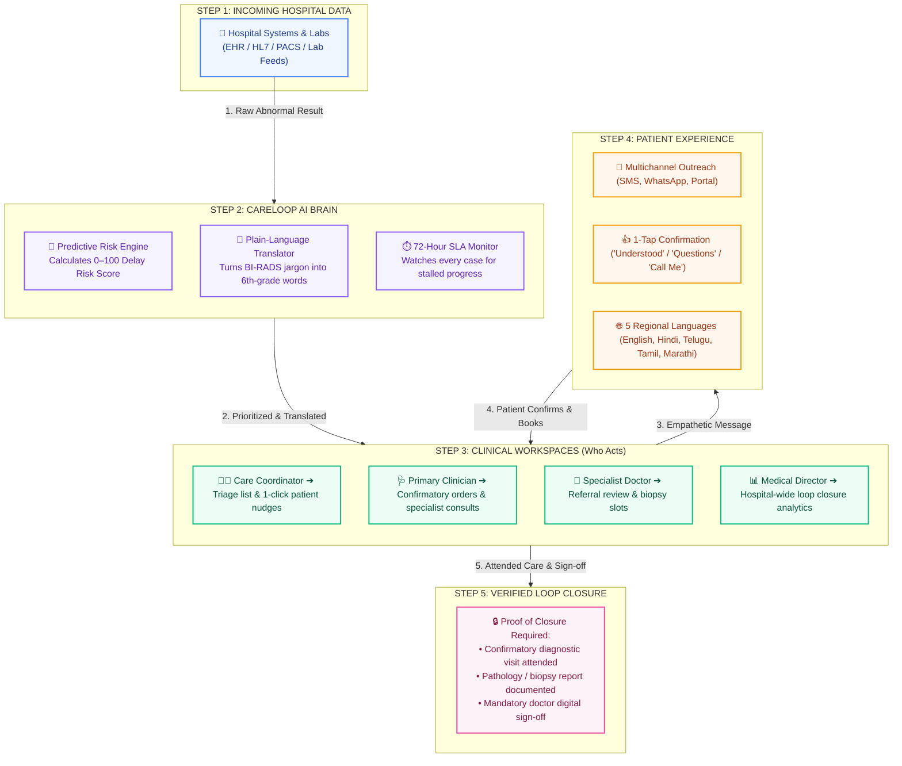
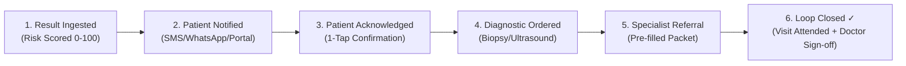

# CareLoop AI

> **Enterprise Healthcare Closed-Loop Navigation Platform**  
> *Closing the dangerous gap between abnormal screenings and confirmed patient care.*

[](https://github.com/srj7042/CareLoop)
[](https://react.dev/)
[](https://www.typescriptlang.org/)
[](https://tailwindcss.com/)
[](./LICENSE)

---

## 💡 How CareLoop Works (In 30 Seconds)

When a patient gets an abnormal screening (like a suspicious mammogram or biopsy), **up to 30% get lost in the system** because of confusing letters, missed phone calls, and manual spreadsheet tracking.

**CareLoop AI solves this in 5 simple steps:**

```
1. Ingest Result  ➔  2. AI Risk Score  ➔  3. Plain-Language Text  ➔  4. Doctor Consult  ➔  5. Verified Loop Closed
  (From Hospital)      (Triage & Prioritize)     (1-Tap Patient Ack)       (Schedule Biopsy)        (Doctor Sign-Off)
```

---

## ⚡ Traditional Healthcare vs. CareLoop AI

| Step | ❌ Without CareLoop (Broken System) | ✅ With CareLoop AI (Closed-Loop System) |
| :--- | :--- | :--- |
| **1. Abnormal Lab Arrives** | Sits in doctor's inbox; days before review. | **Instant automated ingestion**; evaluated in seconds. |
| **2. Risk Assessment** | No prioritization; easy cases mixed with critical. | **ML Delay-Risk Score (0–100)** flags urgent patients first. |
| **3. Patient Notification** | Dense, scary medical jargon mailed via post. | **Empathetic 6th-grade summary** sent via SMS / WhatsApp in preferred language. |
| **4. Patient Response** | Patient panics, delays, or fails to respond. | **1-Tap mobile action**: *"I Understand"*, *"I Have Questions"*, or *"Call Me"*. |
| **5. SLA & Timers** | Cases get forgotten when coordinators are busy. | **Strict 72-Hour SLA Timer** triggers alerts before breaches happen. |
| **6. Loop Closure** | Assumed closed if patient doesn't complain. | **Strict Proof Required**: Attended visit + doctor's digital signature. |

---

## 🏛️ Easy-to-Understand Architecture Diagram

Here is how data flows from hospital systems through our AI and care teams all the way to verified loop closure:



---

## 🔄 The 6-Step Clinical Lifecycle (How Every Case Travels)

Every case in CareLoop moves through 6 clear stages with **human clinician oversight at every milestone**:



1. **Result Ingested:** Abnormal report detected. AI assigns a **Delay Risk Score (0–100)** based on severity and social vulnerability.
2. **Patient Notified:** Multichannel message sent within 24 hours in patient's preferred language.
3. **Patient Acknowledged:** Patient confirms understanding or requests a callback with 1 tap.
4. **Diagnostic Ordered:** Clinician orders confirmatory workup (e.g., targeted ultrasound or biopsy).
5. **Specialist Referral:** Automated clinical handoff sent to specialist; specialist accepts or requests more info.
6. **Verified Loop Closed:** **Loops NEVER close automatically.** Case only closes when proof of treatment/visit is logged and signed off by a human doctor.

---

## 👥 Who Uses CareLoop? (Role-Based Workspaces)

CareLoop gives every member of the care team their own customized view:

| Role | What They See & Do | Key Feature |
| :--- | :--- | :--- |
| **👩‍⚕️ Care Coordinator** | Daily worklist of abnormal results needing action; overdue patients flagged. | **1-Click Nudge**: Sends instant patient outreach reminders. |
| **🩺 Primary Clinician** | Orders confirmatory tests, chats with specialists, and signs off on closed loops. | **Rapid Consult**: Direct in-app chat with specialists. |
| **🔬 Specialist Clinician** | Referral inbox for biopsies, oncology consults, and surgical slots. | **1-Click Triage**: Accept, request more info, or re-route. |
| **🏥 Department Head (HOD)** | Balances coordinator workloads so no single nurse has too many high-risk cases. | **Capacity Load Meter**: Live workload balance bars. |
| **📊 Medical Director** | Hospital-wide loop closure rate, department comparisons, and SLA compliance. | **SLA Analytics**: Tracks hospital-wide performance trends. |
| **👤 Patient & Family** | Friendly mobile portal explaining their test, what happens next, and their care team. | **1-Tap Response**: Instant answers in English, Hindi, Tamil, Telugu, Marathi. |

---

## 🎨 Clean Frosted Glassmorphism Design (`v1.2.0`)

CareLoop AI uses a calm, clinical-grade user interface designed to eliminate eye fatigue and stress:
- **Canvas:** Multi-stop soft pastel gradient (`#E8EEF5` &rarr; `#EAE8F2` &rarr; `#F5EAF0`).
- **Surfaces:** Semi-translucent frosted glass cards (`bg-white/80 backdrop-blur-md rounded-[26px]`).
- **Interactive Micro-Interactions:** Subtle hover elevation (`-2.5px`), soft ambient shadow expansion, and border glow whenever mouse pointer targets any card, block, or button.
- **Accessible Palette:** High-contrast text (`#1E2532`), cool slate descriptions (`#798393`), mint green indicators (`#10B981`), and soft lavender badges (`#8B5CF6`).

---

## 🛠️ Technology Stack

- **Frontend:** React 19.3 + TypeScript 5.9
- **Build Tool:** Vite 8.3
- **Styling:** Tailwind CSS v4, PostCSS
- **Animation:** Motion (Framer Motion 14.6)
- **State Management:** Zustand (with local persistence)
- **Icons:** Lucide React
- **Notifications:** Sonner

---

## 🚀 Quick Start Guide

### 1. Clone & Install
```bash
git clone https://github.com/srj7042/CareLoop.git
cd CareLoop
npm install
```

### 2. Run Locally
```bash
npm run dev
```
Open **`http://localhost:5173`** in your browser.

### 3. Build for Production
```bash
npm run build
```
*(Compiles cleanly with 0 TypeScript/Vite errors)*

---

## 🔒 Security & Medical Governance

- **Strict Patient Privacy (HIPAA-Aligned):** Full data isolation between healthcare organizations and user roles.
- **Human-in-the-Loop:** AI assists and drafts—licensed human clinicians always make final medical decisions.
- **Immutable Audit Trail:** Every message, status change, and doctor sign-off is permanently logged with timestamps.

---

## 📄 License

This project is licensed under the [MIT License](./LICENSE).
